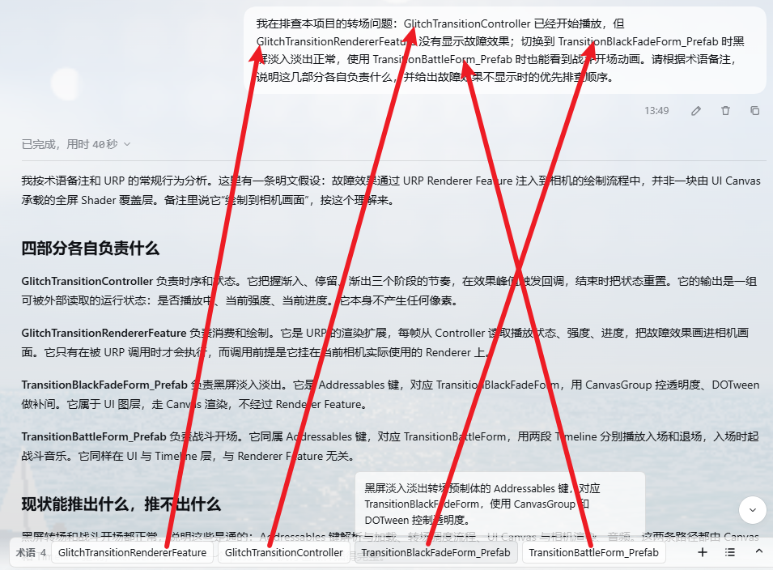
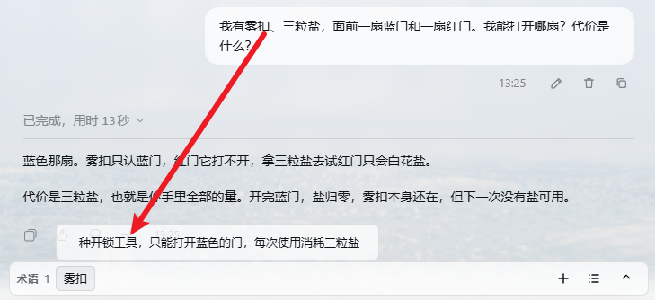
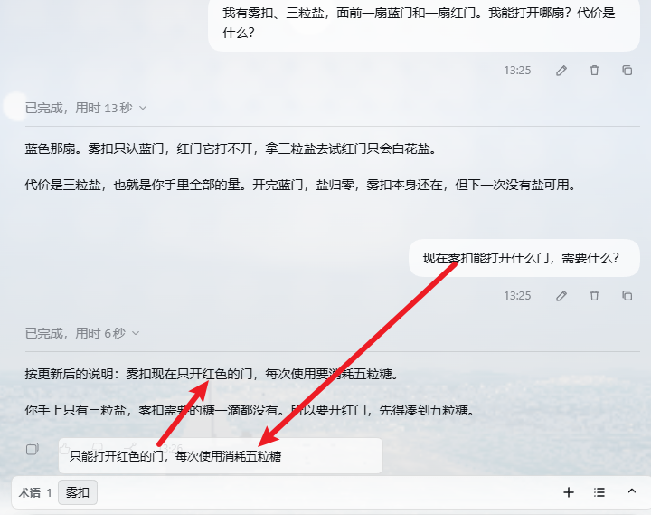
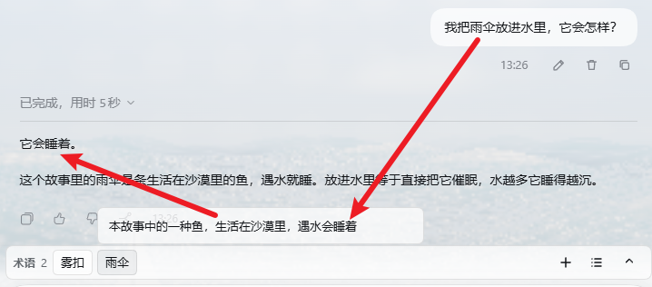

English · [简体中文](README.md)

# Session Terms

Keeps the terms and notes for the current session above the input box in DSH, so you can reuse long names without retyping them and the AI knows what they mean when they come up. Scope is the session only, never global or per-project.

I built this during an internship. Discussing problems with an AI meant copying long component names I could not remember, and the only way to get them back was to scroll through old messages looking for the one I needed. Pinning that long name above the input box would have made the conversation flow again. Once a term is saved you can attach a note, and the AI understands what the name refers to the next time you mention it.

## Install

Compatible with DSH `>=0.2.2-rc.1 <0.3.0-0`; integration-verified against `0.2.2-rc.3`.

Install from the DSH plugin manager:

```text
@fairyonthetree/dsh-session-terms
```

[npm](https://www.npmjs.com/package/@fairyonthetree/dsh-session-terms) · [GitHub](https://github.com/butterfly301/dsh-session-terms)

## Usage

The term bar appears above the input box after the first message in a new session.

- **Add.** Click the add icon, fill in the term and its note, and save. You can also select text in a user message or an AI reply and choose "save as term".
- **Inspect and insert.** Hover a term to read its note, and click it to insert the name into the input box.
- **Edit and delete.** Right-click a term or open the management panel. A single deletion can be undone within eight seconds.
- **Color.** Pick a text color in the term editor and both the term bar and the message text in the current session take that color. Changing the color updates older messages, and choosing the default color restores the body color of the current theme.
- **Find.** Expand the term bar or open the management panel and search by name and note. While collapsed, scroll along the term row to browse.
- **Order.** Drag terms, or the three-line handle in the management panel. From the keyboard, focus the handle and press Alt with the up or down arrow.
- **Bulk delete.** In the management panel click the multi-select icon, tick terms, then click the trash icon to confirm. During a search, select-all applies to the current results and other ticked terms stay ticked.

Names are unique within a term library, and English names are case-sensitive. Saving a name that already exists opens the existing term. Notes accept multiple lines and can be left empty.

If you edit the same term in several windows and the contents conflict, click "load latest" and continue editing.

## Sessions and data

Terms, notes, order and expansion state are stored per conversation lineage and restored after a restart. Forked sessions, including new sessions created by message rollback, share one term library with the source session; a new session starts empty.

Terms from a permanently deleted session need to be cleaned up by hand. Before deleting the session, select all terms in the management panel and delete them.

## How the AI reads notes

When a term appears in a user message, the plugin supplies its name and note to the AI. It skips the term while the full content is still in the active context, and supplies it again once the note changes or the content is lost to context compaction and the term comes up again.

Chinese terms match as consecutive text. English and numeric names match as whole words, case-sensitively. Where matches overlap, the longer term wins.

The AI can query the current session's terms through `session_terms_lookup`. Notes act as background material, and explicit statements in the user's current message take precedence. Deleting a term stops further supply, though content the AI already read may remain in its context.

## Examples

Save a long name from the project as a term and click it when you need it, without hunting through the conversation or retyping it.



On first mention the AI answers from the note.



After the note changes, later answers follow the new meaning.



Give an everyday word a second meaning unrelated to its usual one and the AI answers within that setting.



## Compatibility

- The compatibility range covers later DSH 0.2.x releases. Context deduplication and chat coloring include host adaptations, so run the integration check after upgrading the host.
- A plugin that fully replaces DSH's default input area can affect how the term bar appears.

## Development

After cloning the source from GitHub, run this in the project directory:

```bash
npm ci --legacy-peer-deps
npm test
npm run format:check
```

The interface follows the DSH client language and ships in Chinese and English. For adding a language, the module layout and host integration tests, see the [implementation notes](docs/implementation-options.md); for behavior contracts, see the [feature spec](docs/requirements.md).

If this plugin is useful to you, a star on the repo is appreciated.

## License

[MIT](LICENSE)
