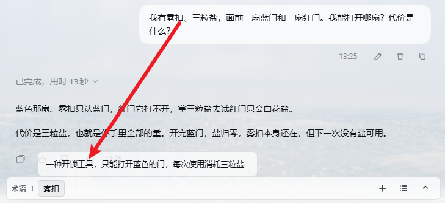
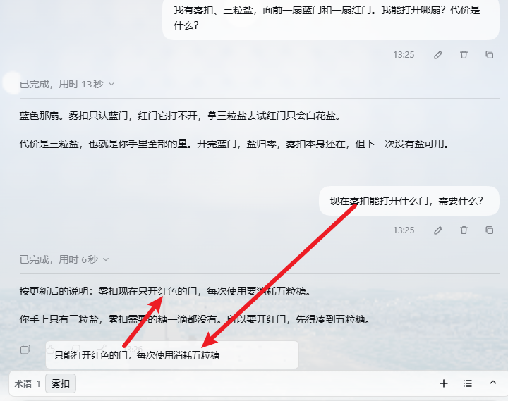
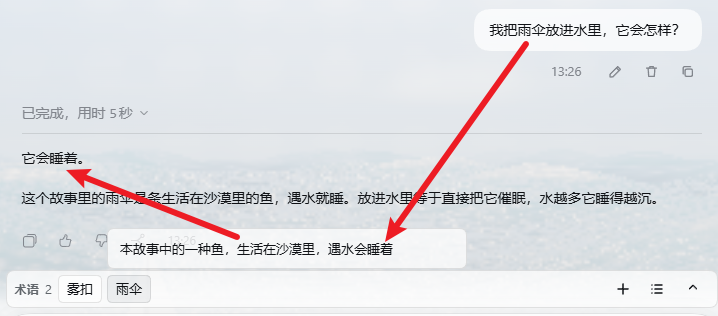

# 会话术语库

在 DSH 输入框上方保存当前会话的术语和备注，方便重复输入，并让 AI 在遇到术语时了解它的含义。

## 安装

适用于 DSH `0.2.2-rc.1`。

在 DSH 插件管理器中安装：

```text
@fairyonthetree/dsh-session-terms
```

[npm](https://www.npmjs.com/package/@fairyonthetree/dsh-session-terms) · [GitHub](https://github.com/butterfly301/dsh-session-terms)

## 使用

新会话发送第一条消息后，输入框上方会出现术语栏。

- **新增**：点击新增图标，填写术语和备注后保存。也可以选中用户消息或 AI 回复中的文字，点击“收录为术语”。
- **查看与插入**：悬停词条查看备注，点击词条将名称插入输入框。
- **编辑与删除**：右键词条，或打开管理面板操作。单条删除后可在八秒内撤销。
- **查找**：展开术语栏或打开管理面板，按名称和备注搜索。收起时可在词条行上滚动浏览。
- **排序**：拖动词条或管理面板中的三横线手柄。键盘操作可聚焦手柄后按 Alt 加上、下方向键。
- **批量删除**：在管理面板中点击多选图标，勾选词条，再点击垃圾桶确认删除。搜索时，全选作用于当前结果，其他已选词条继续保留。

同一会话内的术语名称唯一，英文区分大小写。再次收录同名文字会打开已有词条。备注支持多行文本，也可以留空。

在多个窗口中编辑同一词条时，如果出现内容冲突，可点击“载入最新内容”后继续编辑。

## 会话与数据

术语、备注、顺序和展开状态按会话保存，重启后可以恢复。新会话和分叉会话从空库开始。

会话永久删除后的术语数据需要手动清理，可在删除会话前通过管理面板全选并删除词条。

## AI 如何读取备注

用户消息中出现术语时，插件会向 AI 提供对应名称和备注。完整内容仍在有效上下文中时会跳过重复提供；备注修改后，或内容因上下文压缩而丢失后，再次出现该术语会重新提供。

中文按连续文字匹配，英文和数字名称按完整单词匹配，英文区分大小写。重叠位置优先匹配长词。

AI 可以通过 `session_terms_lookup` 查询本会话术语。备注作为背景资料，用户当前消息中的明确说明优先。删除词条会停止后续提供，AI 已经读到的历史内容仍可能保留在上下文中。

## 示例

首次提到术语时，AI 根据备注回答。



修改备注后，后续回答采用更新后的含义。



将“雨伞”设定为生活在沙漠里的鱼，AI 按这一设定回答。



## 兼容性

- 插件面向 DSH `0.2.2-rc.1`，升级宿主后需要重新验证上下文去重行为。
- 完整替换 DSH 默认输入区的插件可能影响术语栏显示。

## 开发

从 GitHub 克隆源码后，在项目目录执行：

```bash
npm ci --legacy-peer-deps
npm test
npm run format:check
```

界面跟随 DSH 客户端语言，提供中文和英文。新增语言、模块结构和宿主集成测试见[实现说明](docs/implementation-options.md)，行为约定见[功能规格](docs/requirements.md)。

## 许可证

[MIT](LICENSE)
